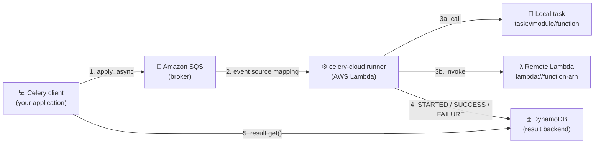

# celery-cloud

**Celery workers without servers.** `celery-cloud` runs your [Celery](https://docs.celeryq.dev) tasks on AWS Lambda: your application keeps using the normal Celery client, and instead of operating a fleet of always-on workers, a Lambda function consumes the queue, executes the task and stores the result where Celery expects it.

Full documentation (installation, configuration, user guide with complete client and server examples, infrastructure guide and API reference): <https://impalah.github.io/celery-cloud/>.

## Why

A classic Celery deployment needs worker processes running (and being paid for, patched and scaled) around the clock, even when the queue is empty. With `celery-cloud`:

- **No workers to manage.** AWS invokes the runner only when there are messages in the queue and scales it for you.
- **No change in the client.** Your code still calls `task.delay(...)` / `task.apply_async(...)` and reads `AsyncResult`, using Celery's own SQS broker and DynamoDB result backend.
- **Most of what a worker does.** Retries with backoff, `eta` / `countdown`, time limits, progress states, `link` / `chain` / `group` / `chord`, `map` / `starmap` / `chunks`, signals, `revoke` and MessagePack / YAML / compression.
- **Your tasks can live anywhere.** A task can be a Python function packaged with the runner, or an existing AWS Lambda function that the runner calls for you.

## How it works



1. The client sends the task to an SQS queue exactly as it would to any Celery broker.
2. SQS triggers the runner Lambda with batches of messages (an *event source mapping*).
3. For every message the runner decodes the Celery task and looks its **name** up in the `TASKS` setting, which maps a task name to where it runs:
   - `task://<module>/<function>`: a Python function packaged with the runner (a *local task*).
   - `lambda://<function-arn>`: another Lambda function, invoked synchronously (a *remote task*).
4. The runner writes the state and the result to DynamoDB using the format of Celery's own DynamoDB backend.
5. The client reads the result with the usual `AsyncResult`.

Only task names listed in `TASKS` can run: a message cannot choose which module is imported or which function is invoked.

## Requirements

- AWS account with permissions to create an SQS queue, a DynamoDB table, an ECR repository, a Lambda function and its IAM role.
- Python **3.12 or newer** for the runner and for development.
- For the client application: `celery[sqs,dynamodb]`. The client does **not** need `celery-cloud`.

## Installation

| Where | What to install |
| --- | --- |
| Client application (sends tasks, reads results) | `pip install "celery[sqs,dynamodb]"` |
| Runner, ready-made container image | nothing: use the published image (see [Deploy the runner](#3-deploy-the-runner)) |
| Runner with your own code, or local development | `pip install celery-cloud` |

`pip install celery-cloud` installs the runner library (`boto3`, `pydantic`, `pynamodb`, `loguru`, `tenacity`, `pybreaker`...). It does not install Celery.

## Quick start

This walks through a complete setup. The commands use the AWS CLI; replace `123456789012` with your account id and `eu-central-1` with your region. Everything except the AWS-side commands (queue, table, ECR, Lambda) has been run end to end against a real Celery 5.7 client with a simulated AWS (see `documentation/05-verificacion-readme.md`); the AWS CLI commands themselves have not been run against a real account.

### 1. Create the queue and the result table

```bash
aws sqs create-queue --queue-name lambda-runner-queue --region eu-central-1

aws dynamodb create-table --table-name lambda-runner-tasks --region eu-central-1 \
  --attribute-definitions AttributeName=id,AttributeType=S \
  --key-schema AttributeName=id,KeyType=HASH \
  --billing-mode PAY_PER_REQUEST
```

The table must have a single string hash key named `id` (no sort key). Both the Celery client and the runner use it.

Optionally, let DynamoDB delete old results automatically (see [Result expiration](#result-expiration)):

```bash
aws dynamodb update-time-to-live --table-name lambda-runner-tasks --region eu-central-1 \
  --time-to-live-specification Enabled=true,AttributeName=ttl
```

### 2. Write your tasks

**Local task.** A Python function in a module that you package with the runner. It receives the **list of positional arguments and the dict of keyword arguments** as two parameters, and returns the result (anything JSON-serialisable):

```python
# my_tasks.py
def add(args: list, kwargs: dict) -> int:
    return sum(args) + kwargs.get("extra", 0)
```

**Remote task.** An existing Lambda function. It is invoked synchronously with the payload `{"args": [...], "kwargs": {...}}`. If the function returns a JSON object with a `body` key, `body` is the result; otherwise the whole returned value is:

```python
# the handler of the remote Lambda function
def handler(event, context):
    return {"body": sum(event["args"])}
```

Then declare where each task name runs, in the `TASKS` setting (a JSON object, see [Task definition](#task-definition)):

```json
{
  "tasks.add": "task://my_tasks/add",
  "tasks.multiply": "lambda://arn:aws:lambda:eu-central-1:123456789012:function:multiply"
}
```

### 3. Deploy the runner

AWS Lambda runs container images that are stored in an **Amazon ECR repository in the same Region as the function**, so copy the runner into your own repository. A published image is available at `public.ecr.aws/e2b2x4l7/celery-cloud/lambda-runner` (browse the existing tags at <https://gallery.ecr.aws/e2b2x4l7/celery-cloud/lambda-runner>; there is no `latest` tag and published tags can be older than the version on PyPI).

**With local tasks**, build your own image on top of the runner image. This is the whole `Dockerfile`:

```dockerfile
FROM public.ecr.aws/e2b2x4l7/celery-cloud/lambda-runner:<tag>
COPY my_tasks.py ${LAMBDA_TASK_ROOT}/
```

**With remote tasks only**, you can use the runner image as it is: no `Dockerfile` is needed beyond pulling and re-tagging it.

Push the image to your ECR repository:

```bash
aws ecr create-repository --repository-name celery-cloud-runner --region eu-central-1
aws ecr get-login-password --region eu-central-1 \
  | docker login --username AWS --password-stdin 123456789012.dkr.ecr.eu-central-1.amazonaws.com

docker build --platform linux/amd64 --provenance=false \
  -t 123456789012.dkr.ecr.eu-central-1.amazonaws.com/celery-cloud-runner:1 .
docker push 123456789012.dkr.ecr.eu-central-1.amazonaws.com/celery-cloud-runner:1
```

(`--platform` must match the architecture of the function, and `--provenance=false` avoids the extra attestation manifest that Lambda does not accept.)

Create the function. The settings go in an `env.json` file, which avoids shell-quoting the `TASKS` JSON:

```json
{
  "Variables": {
    "TASKS": "{\"tasks.add\": \"task://my_tasks/add\"}",
    "CELERY_BACKEND_TABLE": "lambda-runner-tasks",
    "CELERY_BACKEND_REGION": "eu-central-1"
  }
}
```

```bash
aws lambda create-function --function-name celery-cloud-runner --region eu-central-1 \
  --package-type Image \
  --code ImageUri=123456789012.dkr.ecr.eu-central-1.amazonaws.com/celery-cloud-runner:1 \
  --role arn:aws:iam::123456789012:role/celery-cloud-runner \
  --timeout 300 --memory-size 512 \
  --environment file://env.json
```

Connect the queue to the function. `ReportBatchItemFailures` is what lets the runner ask SQS to redeliver only the messages it could not record (see [Partial batch responses](#partial-batch-responses)):

```bash
aws lambda create-event-source-mapping --region eu-central-1 \
  --function-name celery-cloud-runner \
  --event-source-arn arn:aws:sqs:eu-central-1:123456789012:lambda-runner-queue \
  --batch-size 10 \
  --function-response-types ReportBatchItemFailures
```

Set the queue's visibility timeout to at least the function timeout, so a message is not delivered again while it is still being processed.

### 4. Permissions

The runner's execution role needs:

| Service | Actions | Why |
| --- | --- | --- |
| SQS (the queue) | `sqs:ReceiveMessage`, `sqs:DeleteMessage`, `sqs:GetQueueAttributes` | Read the messages (the AWS managed policy `AWSLambdaSQSQueueExecutionRole` includes them, and CloudWatch Logs) |
| SQS (the queue) | `sqs:SendMessage` | Hold a task until its `eta`, retries and the next tasks of a workflow (callbacks, chains, chords) |
| DynamoDB (the table) | `dynamodb:PutItem`, `dynamodb:GetItem`, `dynamodb:UpdateItem`, `dynamodb:DeleteItem` | Register the task and store its state and result; forget a rejected task and clean up chords |
| Lambda (each remote function) | `lambda:InvokeFunction` | Only for `lambda://` tasks |

The client application needs `sqs:SendMessage` on the queue and, on the table, `dynamodb:GetItem` and `dynamodb:DescribeTable` (Celery's DynamoDB backend checks that the table exists when it starts). If you add `?ttl_seconds=...` to the `result_backend` URL, Celery also checks and configures the table's TTL, which needs `dynamodb:DescribeTimeToLive` and `dynamodb:UpdateTimeToLive`.

### 5. Send tasks from your application

This is a complete client. Save it, adjust the constants and run it:

```python
# client.py
from celery import Celery

REGION = "eu-central-1"
QUEUE_NAME = "lambda-runner-queue"
QUEUE_URL = "https://sqs.eu-central-1.amazonaws.com/123456789012/lambda-runner-queue"
TABLE = "lambda-runner-tasks"

app = Celery("task_client")
app.conf.update(
    broker_url="sqs://",
    result_backend=f"dynamodb://@{REGION}/{TABLE}",
    task_default_queue=QUEUE_NAME,
    broker_connection_retry_on_startup=True,
    broker_transport_options={
        "region": REGION,
        # the queue must already exist: the client does not create it
        "predefined_queues": {QUEUE_NAME: {"url": QUEUE_URL}},
    },
)


# The name is what the runner looks up in TASKS: always set it explicitly.
@app.task(name="tasks.add")
def add(x: int, y: int) -> int:
    """Declaration only: the body never runs on the client."""
    raise NotImplementedError


if __name__ == "__main__":
    result = add.apply_async((10, 3))
    print(f"Sent task {result.id}")
    print(f"Result: {result.get(timeout=60)}")
```

```bash
python client.py
# Sent task b900ab7c-838c-47bd-b602-941e4e7cc168
# Result: 13
```

Notes:

- The `name` given to `@app.task` must be exactly the key used in `TASKS`. If you leave it out, Celery derives it from the module name (for example `client.add`), which is easy to get wrong.
- Use `result.get(timeout=...)`: a task whose runner died stays in `STARTED` (see [Duplicate deliveries](#duplicate-deliveries)) and would otherwise be awaited forever.
- Credentials and region come from the standard AWS mechanisms (environment variables, profile, instance role).
- If the task fails, `result.get()` raises **the original exception** (`except ValueError` works; an exception class the client cannot import is recreated with the same name and arguments), and `result.traceback` holds the traceback of the runner.
- `result.revoke()` only works after `celery_cloud.client.install(app)` (see [Revoking](#revoking)); otherwise it is accepted but has no effect.

## Configuration

The runner is configured with environment variables (or an `.env` file if your project uses `python-dotenv`; see `.env.template`).

| Name                  | Description                                                                 | Values                                | Default                       |
| --------------------- | --------------------------------------------------------------------------- | ------------------------------------- | ----------------------------- |
| TASKS                 | Task definition (see below)                                                 | JSON object                           | `{}`                          |
| CELERY_BACKEND_REGION | DynamoDB region                                                             | A string                              | `eu-west-1`                   |
| CELERY_BACKEND_TABLE  | Backend table name                                                          | A string                              | `celery`                      |
| LOG_LEVEL             | Log level for the application                                               | DEBUG, INFO, WARNING, ERROR, CRITICAL | `INFO`                        |
| LOG_FORMAT            | Log format ([loguru](https://loguru.readthedocs.io) format)                 | A string                              | colored, with `trace_id`      |
| LOG_DIAGNOSE          | Dump local variables in tracebacks. **May leak task arguments to the logs** | `true` / `false`                      | `false`                       |
| LOG_ENQUEUE           | Send log records through a queue (multiprocessing-safe)                     | `true` / `false`                      | `false`                       |
| MAX_ATTEMPTS          | Attempts to invoke a remote Lambda when the invocation itself fails         | Integer                               | `5`                           |
| CB_FAIL_MAX           | Consecutive failures that open the circuit breaker of a remote Lambda       | Integer                               | `5`                           |
| CB_RESET_TIMEOUT      | Seconds before an open circuit breaker lets one call through                | Integer                               | `60`                          |
| LAMBDA_INVOKE_TIMEOUT | Seconds to wait for a remote Lambda to answer                               | Integer                               | `840`                         |
| TIMEOUT_MARGIN_SECONDS | Seconds kept free before the Lambda timeout: a task is stopped (and its `FAILURE` stored) this long before AWS would kill the function; records that cannot start with that much time left go back to SQS | Integer >= 0 | `10` |
| RESULT_EXTENDED       | Also store `name`, `args`, `kwargs`, `worker`, `retries` and `queue` in the result (Celery's `result_extended`). **Args may be sensitive** | `true` / `false` | `false` |
| RESULT_TTL_SECONDS    | Seconds a stored result is kept (see [Result expiration](#result-expiration)); `0` = never | Integer >= 0                          | `86400`                       |
| BATCH_CONCURRENCY     | Records of a batch processed at the same time (threads). Above 1 the time limits cannot interrupt a task | Integer >= 1 | `1` |
| RESULT_SERIALIZER     | How results are written; must match the client's `result_serializer` | `json`, `msgpack`, `yaml` | `json` |
| INIT_MODULES          | Modules imported once at start-up (to connect signal receivers), comma separated | `mod1,mod2` | empty |
| METRICS_ENABLED       | Write CloudWatch metrics (Embedded Metric Format) to the log | `true` / `false` | `false` |
| METRICS_NAMESPACE     | CloudWatch namespace of those metrics | A string | `CeleryCloud` |
| DEBUG_MODE            | Wait for a `debugpy` client when `celery_cloud.debug_server` starts         | `true` / `false`                      | `false`                       |
| DEBUG_HOST            | Interface `debugpy` listens on. Do not expose it on untrusted networks      | A host / IP                           | `127.0.0.1`                   |
| SERVER_DEBUG_PORT     | Port `debugpy` listens on                                                   | Integer                               | `5890`                        |

`CELERY_BACKEND_REGION` and `CELERY_BACKEND_TABLE` must point to the same table as the `result_backend` URL of the client.

Integers and booleans are validated at start-up: an invalid value (for example `DEBUG_MODE=maybe`) makes the runner fail immediately with a clear message instead of misbehaving later.

### Task definition

`TASKS` is a JSON dictionary. The key is the name of the task as sent by Celery, and the value is a URL that says where it runs:

| URL | Meaning |
| --- | --- |
| `task://<module>/<function>` | Call `<function>` of the Python module `<module>`, which must be importable inside the runner image. |
| `lambda://<function-arn>` | Invoke the Lambda function with that ARN (an alias or version suffix is accepted). |

```json
{
  "tasks.add": "task://my_tasks/add",
  "tasks.multiply": "lambda://arn:aws:lambda:eu-central-1:123456789012:function:multiply"
}
```

An invalid `TASKS` (not JSON, not an object, or a value without `scheme://`) stops the runner at start-up.

## Behaviour of the runner

### Task states and failures

The runner writes the standard Celery states to the backend so that `AsyncResult` works as usual: `STARTED` when the message is received, then `SUCCESS` (with the return value) or `FAILURE` (with the **original exception** in the Celery format, so `except ValueError` works on the client, and the traceback). Other states: `RETRY`, `REVOKED` (expired or revoked), `REJECTED` and any custom state a task sets with `self.update_state` (e.g. `PROGRESS`). A task that fails, or whose name is not in `TASKS`, is stored as `FAILURE` and never blocks the rest of the batch.

Task arguments are read from the message body, so the client must use Celery's default `json` serializer. Results that JSON cannot represent (`datetime`, `Decimal`...) are stored as their `str()`.

Celery headers honoured by the runner:

- `ignore_result`: nothing is written to the backend (not even failures), like Celery does.
- `expires`: a task received after its expiration time is not executed and is stored as `REVOKED`.
- `soft_time_limit` / `time_limit` (`apply_async(soft_time_limit=30, time_limit=60)`): the task is interrupted with `SoftTimeLimitExceeded` / `TimeLimitExceeded` (the same classes as Celery's, so the client can catch them) and stored as `FAILURE`. The runner also stops a task `TIMEOUT_MARGIN_SECONDS` before the Lambda timeout, so a task that is too slow ends as `FAILURE` instead of staying in `STARTED`. This uses `SIGALRM`, which interrupts Python code but not a C extension that never returns control.

A result larger than about 380 KB does not fit in a DynamoDB item (limit 400 KB): the task is stored as `FAILURE` with a `ResultTooLargeException` explaining the size, and it is not retried.

### Retries, progress and the Celery-like task API

Functions decorated with `@celery_cloud.task` are called with their natural arguments and get what Celery's `@app.task` offers: `bind=True` (`self.request`), `raise self.retry(exc=exc, countdown=30)`, `autoretry_for` with backoff, `self.update_state(state="PROGRESS", meta=...)`, `self.is_revoked()`, `soft_time_limit` / `time_limit`, `on_success` / `on_failure` / `on_retry` and the exceptions `Ignore` and `Reject`. Plain `f(args, kwargs)` functions keep working. A retry is sent again to the queue with the same task id and `retries + 1`; the state is `RETRY` meanwhile. See the [user guide](https://impalah.github.io/celery-cloud/user-guide/server-task-api.html).

```python
from celery_cloud import task

@task(bind=True, max_retries=3, default_retry_delay=30)
def fetch(self, url: str) -> str:
    try:
        return download(url)
    except ConnectionError as exc:
        raise self.retry(exc=exc)
```

### Delayed tasks (`eta` / `countdown`)

`apply_async(countdown=60)` and `eta=...` are honoured. SQS delays a message at most 15 minutes, so the runner holds the task in steps: it sends the same message back to the queue with the longest delay that does not overshoot until the task is due (one extra SQS message every 15 minutes while it waits; a task never runs early). Needs `sqs:SendMessage` on the queue.

### Workflows (`link`, `chain`, `group`, `chord`, `map`...)

The runner starts the next tasks of a workflow when a task ends, as a Celery worker does: `link` callbacks receive the result, a `chain` passes the result to the next step, a `chord` runs its body with the list of results when the last task of the header ends (using Celery's own `chord_count` counter), `link_error` callbacks receive the failed task id (classic errback form), and `map` / `starmap` / `chunks` run the task once per item inside the invocation. A failed chord header makes the body a `FAILURE` with `ChordError`. If the next messages cannot be sent the finished task keeps its result and the problem is only logged.

### Revoking

`celery_cloud.client.install(app)` makes `result.revoke()` work by writing a `REVOKED` result with a `revoked` flag to the backend: a task that has not started never starts; a running task is only flagged and stops if it checks `self.is_revoked()`. It is optional and the only place where a client uses `celery-cloud` (it needs only `boto3`).

### Serializers and compression

JSON by default. MessagePack and YAML need the extras `celery-cloud[msgpack]` / `[yaml]` (in the image) and `RESULT_SERIALIZER`. Messages compressed with `gzip` (kombu's zlib; a real gzip stream is also accepted), `bzip2` or `lzma` are understood. `pickle`, brotli and zstd are not supported.

### Result expiration

Every item the runner writes carries a `ttl` attribute: the epoch second after which the item can be deleted, `RESULT_TTL_SECONDS` (default 24 hours) after the last change of state. It is the same attribute, type and unit that Celery's own DynamoDB backend uses, so both can share a table.

The attribute does nothing by itself: **DynamoDB only deletes expired items once TTL is enabled on the table for the attribute `ttl`**, which is the `update-time-to-live` command of the [quick start](#1-create-the-queue-and-the-result-table). Until then results are kept forever. Set `RESULT_TTL_SECONDS=0` to stop writing the attribute.

DynamoDB deletes expired items some time after they expire, not at the exact second. Failed tasks and tasks stuck in `STARTED` expire too.

Once an item is deleted the runner no longer remembers that task id, so a very late redelivery of the same message would run it again (see [Duplicate deliveries](#duplicate-deliveries)). Keep `RESULT_TTL_SECONDS` longer than the retention period of the queue if that matters to you.

### Duplicate deliveries

SQS delivers messages at least once. The runner registers each task with a conditional write, so only the first delivery of a task id is executed; later deliveries are reported in `skipped_tasks` and discarded. Consequences:

- If the runner dies while a task is `STARTED` (for example it runs out of memory; a timeout is handled by the time limits above), SQS redelivers the message but it is discarded as a duplicate and the task stays `STARTED`. Give the client a timeout, as in the example above.
- Tasks sent with `ignore_result` have no record in the backend, so they cannot be de-duplicated.
- Re-sending a task with an already used task id is treated as a duplicate.

### Partial batch responses

Every record of an SQS batch is processed independently and the handler always returns a response with the counters and the lists of processed, failed and skipped tasks. When the state of a task **could not be stored in the backend** (for example DynamoDB is unavailable) the message id is returned in `batchItemFailures`, so SQS delivers it again. This only works when the event source mapping has `ReportBatchItemFailures` enabled (the `create-event-source-mapping` command above does it):

```
FunctionResponseTypes: ["ReportBatchItemFailures"]
```

Without it, SQS deletes every message of a batch whose invocation did not raise, so those messages are not retried. Application failures (the task raised an exception) are **not** retried by SQS: they are reported as `FAILURE`, like Celery does.

### Remote Lambda tasks

`lambda://<function-arn>` invokes the function synchronously with `{"args": [...], "kwargs": {...}}` and uses the `body` key of the response when present. Invocation errors (throttling, network) are retried up to `MAX_ATTEMPTS` times; an error *returned by the function* is never retried because the function already ran. Each function has its own circuit breaker.

## Local development

- `celery_cloud.debug_server` is a small FastAPI application that exposes `POST /lambda`, which runs the handler with the event you post, without AWS. It needs the development dependencies (`uv sync`) and starts with `uv run uvicorn celery_cloud.debug_server:app`. With `DEBUG_MODE=true` it waits for a `debugpy` client.
- The container image can be run locally with the Lambda Runtime Interface Emulator that the AWS base image includes: `docker run -p 9000:8080 <image>`, then `POST http://localhost:9000/2015-03-31/functions/function/invocations` with an SQS event.
- `make check` runs lint, type checking and the security scan, `make test` runs the tests, and `make mutation` runs the (slow, manual) mutation tests.

## Known limitations

- A task must finish in less than **15 minutes**, the maximum timeout of an AWS Lambda function. It applies to local and remote (`lambda://`) tasks alike, and a remote function must finish before the runner's own timeout.
- Only SQS events are supported.
- Celery's remote control (`inspect`, `control`...) does not exist, there are no workers to ask. `revoke` works through the backend with a client helper.
- No `celery beat`: schedule periodic tasks with EventBridge Scheduler (see the [guide](https://impalah.github.io/celery-cloud/infrastructure/periodic-tasks.html)).
- No `rate_limit`, task classes (`base=`), `pickle`, brotli/zstd or result compression. Results above about 380 KB are a `FAILURE`.
- A workflow's next messages are sent after the task stores its result; if SQS rejects them the callback is lost (logged).

## License

[Mozilla Public License 2.0](LICENSE) (MPL-2.0). You may use the library in proprietary projects; modifications to the MPL-licensed files themselves must be published under the same licence.
